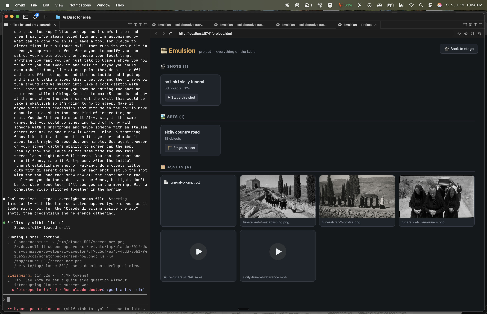
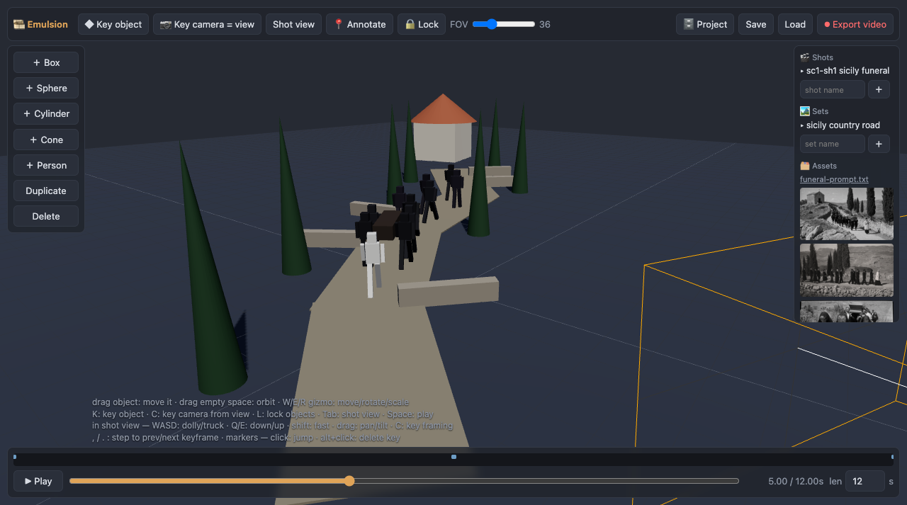
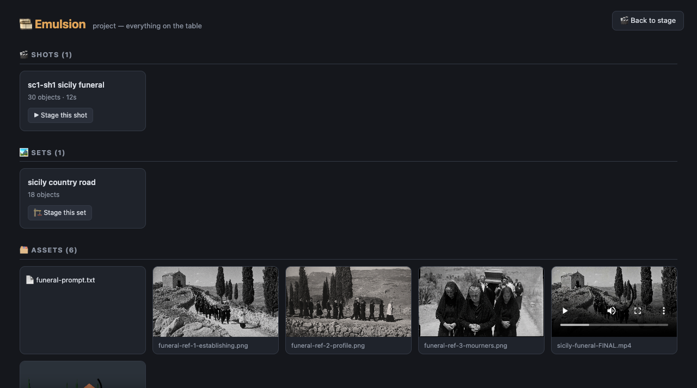

# 🎞️ Emulsion

**Storyboard blocking for AI filmmaking, directed by you and Claude together, live.**

Emulsion is a Claude Code skill that ships its own three.js app. You block scenes
with rough primitives and blocky people, keyframe the action and a shot camera,
and export a motion/camera reference clip for AI video models (Seedance 2 and
similar). The agent edits the scene inside the app while you watch, and you can
change anything by hand.

**Status:** working tool, used to make the worked example linked below. It has no
automated test suite, and the roadmap features at the bottom are not built.

**From blocking to film:** a reference clip exported from Emulsion (left) and the
frame a video model generated from it (right).


## Run it

```sh
npx skills add dennisonbertram/emulsion     # via skills.sh
# or manually:
git clone https://github.com/dennisonbertram/emulsion ~/dev/emulsion
ln -s ~/dev/emulsion ~/.claude/skills/emulsion
```

Then ask Claude Code something like "storyboard a chase scene for me". The agent
starts the bridge (`python3 server.py`, port 8741), opens the app in your browser,
and directs.

To use it without an agent, run `python3 server.py` and open http://localhost:8741.
It needs Python 3 and a browser; Node is needed only for the headless helpers.



## What you can do

- **Block:** box, sphere, cylinder, cone and person objects; drag or use the gizmo
  (`W`/`E`/`R`); non-uniform scale makes roads, walls and props.
- **Keyframe:** `K` keys the selected object, `C` keys the camera. Shot view (`Tab`)
  gives camera controls (dolly, boom, pan/tilt, FOV).
- **Direct with Claude:** the agent sees your edits before its next change. Click
  **📍 Annotate**, click an object, and paste the token into chat
  (for example `@person#2 t=4.20s`).
- **Export:** **⏺ Export video** renders the shot camera to MP4 in the asset shelf.
  Exports are versioned.
- **Organize:** 🎬 Shots save layouts, 🏞 Sets save scenery, 🗂 Assets collects
  reference images, prompts and exports. 🔒 Lock (`L`) freezes the blocking.



## Pipeline

1. Block the scene and camera move.
2. Export the shot camera to MP4 as the reference clip.
3. Generate reference stills with an image model of your choice.
4. Write a beat-by-beat prompt matching the timeline.
5. Feed clip, stills and prompt to a video model.

A complete worked example (blocking exports, stills, prompts, generated film and a
promo cut) is in the
[media release](https://github.com/dennisonbertram/emulsion/releases/tag/media-v1).
The project view shows shots, sets and assets together:



## Repo map

```
index.html + app.js   the editor (three.js from CDN, no build step)
server.py             stdlib bridge: static hosting, op log, scene state,
                      shot/set libraries, annotations, assets
export.mjs            headless export driver (records the shot camera to MP4)
qa.mjs                headless CDP probe for verifying frames
SKILL.md              agent-facing manual (op catalog, spec format, camera rigs)
shots/  sets/  assets/  your project, as plain JSON and files
examples/             example scene script
docs/                 screenshots
```

Sync is simple: agents POST full scene specs to `/op`, browsers poll and apply them
(sequence numbers drop stale ops), the app pushes user edits back to `/state`, and
the last writer wins. See [SKILL.md](SKILL.md) for details.

## Roadmap (help wanted)

None of these exist yet.

- **Motion:** spline paths with timing handles, pose presets, secondary motion.
- **Editing:** a sequence timeline with trims, versioned cuts, EDL/JSON export.
- **Audio:** dialogue/beat markers that flow into the prompt, temp ambience and music, audio annotations.
- **Camera:** rig presets (orbit, dolly, crane, push-in), handheld shake, framing guides.
- **Sets:** a richer prop kit, lighting presets.
- **Collaboration:** per-object patch ops, range annotations, an MCP server exposing the op catalog, pluggable generation backends.

PRs are welcome, and the skill instructs agents to offer improvements upstream
(telling you first, so you can decline). Open an issue with your use case, or send a PR.

## License

MIT
