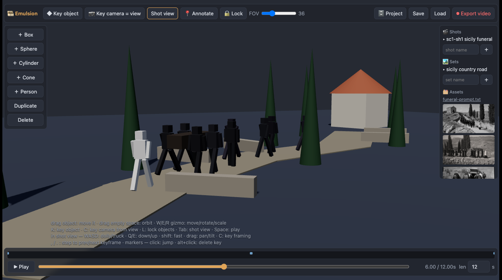

# 🎞️ Emulsion

**Storyboard blocking for AI filmmaking — directed by you and Claude, together, live.**

Emulsion is a Claude Code skill that ships its own three.js app. You block
scenes with rough primitives and blocky people, keyframe the action and a shot
camera, and export a motion/camera reference clip for AI video models
(Seedance 2 and friends). The agent works *inside the app while you watch* —
every edit it makes streams into your browser, it narrates as it goes, and you
can grab anything and change it by hand.

**From blocking to film** — a reference clip exported from Emulsion (left) and
the frame a video model generated from it (right):


## How it feels

You talk to Claude in the terminal; the app runs beside it:


- *"Block me a funeral procession on a winding country road, 1930s camera."*
  → the scene assembles in front of you, narrated with toasts.
- Drag a person somewhere better; the agent sees your edit before its next change.
- Click **📍 Annotate**, click the thing that bugs you, paste the copied token
  into chat: *"`@person#2 t=4.20s` — slower here."*
- **⏺ Export video** renders the shot camera to MP4, straight into the
  project's asset shelf — that's your reference clip for the video model.

## Install

```sh
npx skills add dennisonbertram/emulsion     # via skills.sh
# or manually:
git clone https://github.com/dennisonbertram/emulsion ~/dev/emulsion
ln -s ~/dev/emulsion ~/.claude/skills/emulsion
```

Then in any Claude Code session: *"storyboard a chase scene for me"* — the
agent starts the bridge (`python3 server.py`, port 8741), opens the app in
your browser, and directs.

Run it without an agent: `python3 server.py` and open http://localhost:8741 —
it's a perfectly good manual blocking tool.

## The workspace


- **Objects**: box / sphere / cylinder / cone / person. Drag a body to slide it
  on the ground, gizmo (`W`/`E`/`R`) for precise moves. Non-uniform scale turns
  boxes into roads, walls, props. People auto-walk when their keys move them.
- **Keyframes**: `K` keys the selected object at the playhead; keyed objects
  re-key when you drag them. Eased by default, `linear` for constant speed.
  `,`/`.` step through every key. Markers: blue = camera, orange = object.
- **Camera**: frame your view and press `C` to key it, or enter **Shot view**
  (`Tab`) and operate it like a camera: `WASD` dolly/truck, `Q`/`E` boom,
  drag to pan/tilt, FOV slider zooms, `C` keys the framing. `camera.follow`
  auto-tracks a subject.
- **🔒 Lock** (`L`) freezes the blocking while you browse.
- **🎬 Shots** save whole layouts; **🏞 Sets** save just the scenery — load a
  set to stage a new shot in the same place. **🗂 Assets** collects every
  reference image, prompt, and export (exports save versioned — nothing is
  overwritten).

Through the shot camera:



## The project view

Everything on one table — shots, sets, and assets, with one-click staging:


## The pipeline

1. **Block** the scene — objects, keyframes, camera move (by hand, by agent,
   or both).
2. **Export** the shot camera to MP4 — the motion/camera reference.
3. **Reference stills** — generate style frames with your image model of
   choice; they collect in the asset shelf.
4. **Prompt** — a beat-by-beat description matching the blocking timeline.
5. **Generate** — feed reference clip + stills + prompt to a video model.

A complete worked example (blocking exports, stills, prompts, generated film,
and a promo cut made entirely through this pipeline) lives in the
[media release](https://github.com/dennisonbertram/emulsion/releases/tag/media-v1).

## Architecture

```
index.html + app.js   the editor (three.js from CDN, no build step)
server.py             stdlib bridge: static hosting + op log (the app polls),
                      scene state, shot/set libraries, annotations, assets
qa.mjs                headless CDP probe for verifying frames
export.mjs            headless export driver (records the shot camera to MP4)
SKILL.md              the agent-facing manual (op catalog, spec format,
                      camera-rig recipes)
shots/  sets/  assets/  your project, as plain JSON and files
```

The sync design is deliberately simple: agents POST full scene specs to `/op`,
browsers poll and apply them (sequence numbers drop stale ops), the app pushes
user edits back to `/state`, and last writer wins. No CRDTs, no build step, no
dependencies beyond Python 3, Node (for the headless helpers), and a browser.

## Roadmap — help wanted

PRs are very welcome; the skill even instructs agents to contribute
improvements back upstream automatically. Rough priorities:

**Motion**
- Spline paths with timing handles — separate the walked path from the
  schedule ("arrive later" without re-authoring keys)
- Pose presets (sit, kneel, carry, point, embrace) blended over the walk cycle
- Secondary motion: walk bob, torso counter-rotation, camera damping

**Editing controls**
- A sequence timeline: order shots into a cut, trim in/out points per shot,
  export the whole sequence as one reference video
- Versioned cuts with side-by-side compare
- EDL/JSON export for real NLEs

**Audio controls**
- Beat/dialogue markers on the timeline that flow into the generation prompt
  ("line lands at 4.2s")
- Temp ambience/music tracks under preview and export
- Audio annotations — click a moment, describe what it should sound like

**Camera**
- Rig presets in the UI (orbit / dolly / crane / push-in) that bake ordinary
  keyframes
- Handheld/shake flavor, DOF and framing guides (thirds, headroom)

**Sets & world**
- A richer prop kit (stairs, arches, vehicles, terrain/elevation)
- Lighting presets: time of day, key/fill direction, weather

**Collaboration & agents**
- Per-object patch ops (merge instead of replace), interaction leases during
  drags
- Range/path annotation targets (`@camera:2.0–6.0s`), pulse highlight on
  whatever the agent just changed
- An MCP server exposing the op catalog so any agent framework can direct
- Pluggable generation backends (bring your own image/video model CLI)

Open an issue with your use case, or just send the PR.

## License

MIT — free for anyone to use and modify.
